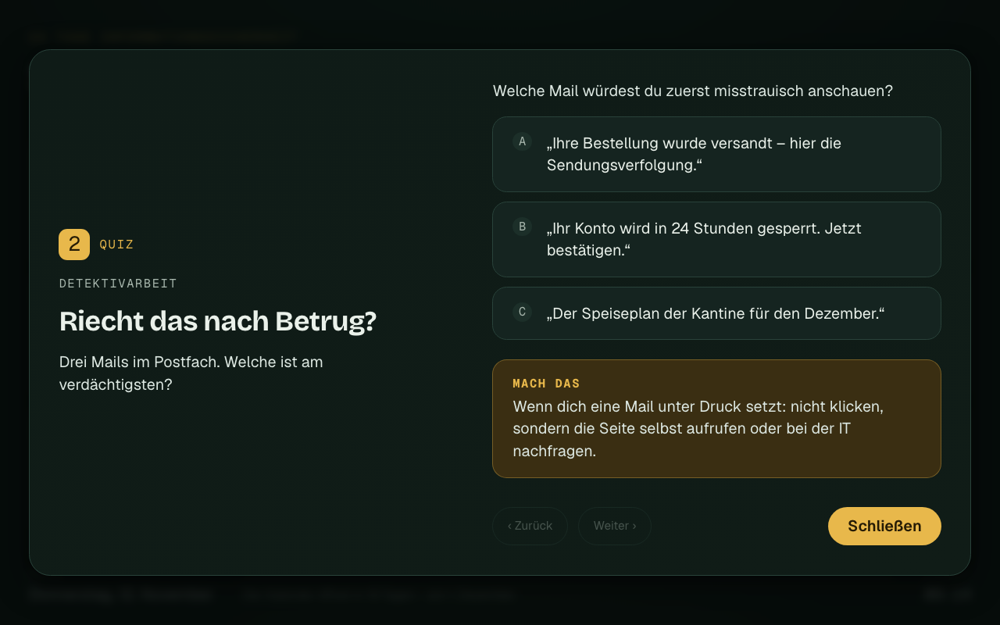

# Sicherheitskalender

Ein Adventskalender für ein digitales Werbedisplay (Kundenstopper): 24 Türchen
Informationssicherheit, ein Türchen pro Tag. Reine statische Seite — kein
Server, keine Datenbank, kein Build-Schritt.




## Starten

```sh
python3 -m http.server 8099
```

Dann <http://localhost:8099> öffnen. Für den Kiosk die Seite im Browser im
Vollbild zeigen (Chrome: `F11`, macOS: `Ctrl+Cmd+F`).

## Auf dem Display

- **Geschlossen** ist jedes Türchen, dessen Tag noch nicht gekommen ist. Antippen
  verrät, wann es aufgeht.
- **Heute** ist gold hinterlegt und wird zuerst gezeigt.
- **Automatik**: Ohne Berührung öffnet sich alle ~35 s ein offenes Türchen und
  bleibt 30 s stehen. Ungelesene kommen zuerst dran. Wer den Bildschirm
  anfasst, pausiert die Rotation für fünf Minuten.
- Nach Mitternacht wandert der Kalender von selbst weiter — der Kiosk muss
  weder neu geladen noch neu gestartet werden.

Bedienbar per Touch und Maus; mit Tastatur `←`/`→` blättern, `Esc` schließen.

### Testen ohne Datumsreise

| Parameter | Wirkung |
|---|---|
| `?datum=2026-12-07` | So tun, als wäre der 7. Dezember |
| `?auto=aus` | Automatik aus, nur Berührung öffnet |
| `?tur=14` | Ein bestimmtes Türchen direkt zeigen |

Beispiele: <http://localhost:8099/?datum=2026-12-07&auto=aus> ·
<http://localhost:8099/?tur=2>

## Inhalte bearbeiten

Alle Texte stehen in [`content/advent.json`](content/advent.json). Drei Arten
von Türchen:

| `kind` | Felder |
|---|---|
| `tipp` | `lead`, `body`, `action` |
| `quiz` | `question`, `options[]`, `correct` (Index), `explanation`, `action` |
| `challenge` | `steps[]`, `action` |

Das 24. Türchen ist eine Challenge mit den vier Gewohnheiten als Schritte und
einem `closing`-Text ("Frohe Weihnachten!"). `closing` wird bei jedem Türchen
angezeigt, wenn vorhanden.

Prüfen, ob alles vollständig und lesbar lang ist:

```sh
python3 tools/check_content.py
```

Das Skript meckert bei Lücken in 1–24, fehlenden Feldern, Quiz-Antworten ohne
gültigen Index und zu langen Texten — eine Tür muss aus drei Metern in rund
20 Sekunden erfassbar sein.

### Eigenes Jahr / eigene Inhalte

`year` in `advent.json` setzt das Kalenderjahr. Für ein anderes Jahr nur diese
Zahl ändern; die Türchen selbst sind jahresunabhängig formuliert.

## Aufbau

```
index.html            Grundgerüst, alle Inhalte kommen aus dem JSON
content/advent.json   24 Türchen
static/style.css      Layout und Farben (Tokens, Dark Mode, Kiosk-Skalierung)
static/app.js         Datumslogik, Automatik, Quiz, Schnee
static/fonts/         Geist, Geist Mono, Bricolage Grotesque (OFL)
tools/check_content.py
_selftest.html        Browsertests, s. u.
```

Schrift und Farben skalieren über `clamp()` mit der kürzeren Bildschirmkante
(`svmin`): Auf dem 43-Zoll-Display ist alles groß, auf dem Handy bleibt das
Raster 4 × 6 und scrollt.

## Tests

```sh
python3 tools/check_content.py
python3 -m http.server 8099 &          # Server muss laufen
"/Applications/Google Chrome.app/Contents/MacOS/Google Chrome" \
  --headless=new --virtual-time-budget=20000 --dump-dom \
  http://localhost:8099/_selftest.html
```

`_selftest.html` prüft Quiz-Auswertung, Automatik, Datumszustände (November,
Dezember, Januar) und den Fortschrittsbalken. Die Datei ist nur zum Testen da
und wird nicht ausgeliefert, wenn der Webserver nur `index.html` bedient.

## Kiosk

Der Kundenstopper (Android 11) zeigt die Seite in einem Browser im Vollbild.
Zwei Wege:

1. **Lokal**: Ordner auf das Gerät kopieren, eine kleine Datei-Server-App oder
   einen Browser mit `file://`-Öffnung nutzen. Achtung: `file://` blockiert
   `fetch()` in Chrome — dann braucht es einen Server.
2. **Im Netz**: Ordner auf einen beliebigen Webserver legen (Caddy, nginx,
   GitHub Pages). Es gibt keine Server-Logik, nur drei Dateien plus Fonts.

Für Dauerbetrieb: Bildschirmsperre und Standby im Android-Menü abschalten,
Browser im Vollbild/Kiosk-Modus starten.

## Lizenzen

Schriften **Geist**, **Geist Mono** (SIL Open Font License 1.1) und
**Bricolage Grotesque** (SIL Open Font License 1.1), Lizenzen unter
`static/fonts/`.
