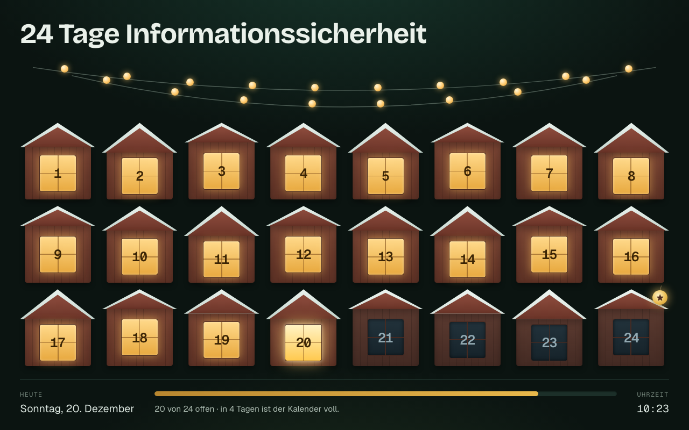

# infosec-advent — 24 Tage Informationssicherheit

Ein Adventskalender für ein digitales Werbedisplay (Kundenstopper): 24 Türchen
Informationssicherheit, ein Türchen pro Tag. Reine statische Seite — kein
Server, keine Datenbank, kein Build-Schritt.

> A 24-door advent calendar for infosec awareness, built for a touchscreen
> kiosk. Each door is a little Christmas hut that lights up on its day. Pure
> HTML/CSS/JS, no build step, German content, ships with a Linux kiosk
> launcher.




## Starten

```sh
python3 -m http.server 8099
```

Dann <http://localhost:8099> öffnen. Auf dem Kundenstopper (Linux Mint) gibt
es dafür `tools/kiosk.sh` — siehe [Kiosk](#kiosk-linux-mint).

## Auf dem Display

- Jedes Türchen ist eine kleine Hütte: Satteldach mit Schnee, Holzwand, ein
  Fenster mit der Tageszahl. Geschlossen ist das Fenster dunkel, geöffnet
  leuchtet es warm — heute am hellsten.
- Über dem Dorf hängen zwei Lichterketten mit blinkenden Birnen; die Dächer
  haben drei Höhen im Wechsel, und über Tür 24 hängt ein Sternenschild.
- **Heute** ist gold hinterlegt und wird zuerst gezeigt.
- **Automatik**: Ohne Berührung öffnet sich alle ~35 s ein offenes Türchen und
  bleibt 30 s stehen. Ungelesene kommen zuerst dran. Wer den Bildschirm
  anfasst, pausiert die Rotation für fünf Minuten.
- Nach Mitternacht wandert der Kalender von selbst weiter — der Kiosk muss
  weder neu geladen noch neu gestartet werden.

Bedienbar per Touch und Maus; mit Tastatur `←`/`→` blättern, `Esc` schließen.

### Türchen testen

Der Kalender rechnet mit dem echten Datum — im November sind deshalb alle
Türen zu. Zum Durchklicken gibt es drei Wege.

**1. Auf dem Rechner (Adresszeile):**

| Parameter | Wirkung |
|---|---|
| `?datum=2026-12-07` | So tun, als wäre der 7. Dezember — Türen 1–7 offen, 7 ist „heute“ |
| `?tur=14` | Ein bestimmtes Türchen direkt öffnen |
| `?auto=aus` | Automatik aus, nur Klick öffnet |
| `?alle=1` | Alle 24 Türchen offen, unabhängig vom Datum — zum Durchklicken |
| `?liste=1` | Alle 24 Texte untereinander zum Korrekturlesen |

Beispiele: <http://localhost:8099/?datum=2026-12-07&auto=aus> ·
<http://localhost:8099/?tur=2> · <http://localhost:8099/?alle=1> ·
<http://localhost:8099/?liste=1>

**2. Auf dem Kundenstopper:** Der Kiosk hat keine Adresszeile, deshalb bringt
`tools/kiosk.sh` einen Testmodus mit — normales Fenster, Automatik aus:

```sh
tools/kiosk.sh --test                 # alle 24 offen, durchklicken
tools/kiosk.sh --test 2026-12-07      # Stand 7. Dezember
```

Der Testmodus nutzt ein eigenes Browser-Profil (`~/.cache/infosec-advent/
chromium-profile-test`), damit er nicht im laufenden Kiosk-Fenster landet.
Beendet wird er mit `Strg+C` im Terminal; das Fenster schließen reicht nicht,
weil der Server dann für weitere Tests weiterläuft.

Der Testmodus lässt Bildschirmschoner und Sperre in Ruhe. Fenster schließen
beendet ihn. Ein zweiter Testmodus-Start während der Kiosk läuft, beendet den
Kiosk nicht.

**3. Automatisch:** `_selftest.html` prüft Quiz-Auswertung, Rotation,
Datumszustände und die Listenansicht (siehe unten).

## Inhalte bearbeiten

Alle Texte stehen in [`content/advent.json`](content/advent.json). Drei Arten
von Türchen:

| `kind` | Felder |
|---|---|
| `tipp` | `lead`, `body`, `action` |
| `quiz` | `question`, `options[]`, `correct` (Index), `explanation`, `action` |
| `challenge` | `steps[]`, `action` |

Das 24. Türchen ist eine Challenge mit den vier Gewohnheiten als Schritte und
einem `closing`-Text ("Frohe Weihnachten!"). `closing` wird bei jedem Türchen
angezeigt, wenn vorhanden.

Prüfen, ob alles vollständig und lesbar lang ist:

```sh
python3 tools/check_content.py
```

Das Skript meckert bei Lücken in 1–24, fehlenden Feldern, Quiz-Antworten ohne
gültigen Index und zu langen Texten — eine Tür muss aus drei Metern in rund
20 Sekunden erfassbar sein.

### Eigenes Jahr / eigene Inhalte

`year` in `advent.json` setzt das Kalenderjahr. Für ein anderes Jahr nur diese
Zahl ändern; die Türchen selbst sind jahresunabhängig formuliert.

## Aufbau

```
index.html            Grundgerüst, alle Inhalte kommen aus dem JSON
content/advent.json   24 Türchen
static/style.css      Layout und Farben (Tokens, Kiosk-Skalierung)
static/app.js         Datumslogik, Automatik, Quiz, Schnee
static/fonts/         Geist, Geist Mono, Bricolage Grotesque (OFL)
tools/kiosk.sh        Server + Chromium im Vollbild, Neustart bei Absturz
tools/install-kiosk.sh  Autostart einrichten/entfernen
tools/check_content.py
tools/screenshots.sh  README-Bilder neu erzeugen
deploy/               Autostart-Vorlage (.desktop)
_selftest.html        Browsertests, s. u.
```

Schrift und Farben skalieren über `clamp()` mit der kürzeren Bildschirmkante
(`svmin`): Auf dem 43-Zoll-Display ist alles groß, auf dem Handy bleibt das
Raster 4 × 6 und scrollt.

## Tests

```sh
python3 tools/check_content.py
python3 -m http.server 8099 &          # Server muss laufen
"/Applications/Google Chrome.app/Contents/MacOS/Google Chrome" \
  --headless=new --virtual-time-budget=20000 --dump-dom \
  http://localhost:8099/_selftest.html
```

`_selftest.html` prüft Quiz-Auswertung, Automatik, Datumszustände (November,
Dezember, Januar) und den Fortschrittsbalken. Die Datei ist nur zum Testen da
und wird nicht ausgeliefert, wenn der Webserver nur `index.html` bedient.

Die Bilder in dieser README erzeugt `tools/screenshots.sh`. Wichtig ist dort
`--force-prefers-reduced-motion`: Ohne das Flag landet die Aufnahme mitten in
der Einblend-Animation der Detailkarte und zeigt sie halb transparent.

## Kiosk (Linux Mint)

Der Kundenstopper läuft auf Linux Mint (Cinnamon). Die Seite ist statisch —
es braucht keinen Webserver von außen, nur einen lokalen, weil Chromium
`fetch()` auf `file://` blockiert.

### Einmal einrichten

```sh
sudo apt install chromium unclutter
tools/install-kiosk.sh
```

`tools/kiosk.sh` sucht selbst nach einem Browser — in dieser Reihenfolge:

1. `BROWSER=/pfad/zum/browser` (wenn gesetzt)
2. Chromium-Familie: `chromium`, `chromium-browser`, `google-chrome`,
   `brave-browser`, `microsoft-edge`, `vivaldi` — auch als Snap, Flatpak
   und unter `/Applications` (macOS)
3. Firefox / Firefox ESR (Mint-Standard)

Welcher Browser starten würde, ohne ihn wirklich zu öffnen:

```sh
tools/kiosk.sh --dry-run
```

Kommt „Kein Browser gefunden“, fehlt Chromium — `install-kiosk.sh` bricht dann
ab, statt einen Autostart einzurichten, der am 1. Dezember nichts zeigt.

`install-kiosk.sh` legt `~/.config/autostart/infosec-advent.desktop` an und
schaltet in Cinnamon Bildschirmschoner, Standby und automatische Sperre ab.
Nach dem nächsten Login startet der Kalender im Vollbild; stürzt Chromium ab,
startet `tools/kiosk.sh` es nach zwei Sekunden neu.

Rückgängig: `tools/install-kiosk.sh --remove`.

Das Display startet den Browser im eingeloggten Benutzerkonto. Wer nicht
möchte, dass der Kiosk in der normalen Sitzung mitläuft, legt einen eigenen
Benutzer `kalender` an, meldet sich dort einmal an und richtet den Autostart
in dessen Konto ein (automatischer Login in den Systemeinstellungen).

### Von Hand starten

```sh
tools/kiosk.sh
```

Das Skript startet den lokalen Server auf Port 8099 (nur auf 127.0.0.1
gebunden), öffnet den gefundenen Browser im Kiosk-Modus und lässt ihn in einer
Schleife laufen. Ein zweiter Start bricht ab, solange der erste läuft
(„Der Kiosk läuft bereits“) — beenden mit `kill <PID>`, die PID steht auch in
`/tmp/infosec-advent-kiosk-<uid>/pid`.

Anderer Port: `PORT=8123 tools/kiosk.sh`. Anderer Browser:
`BROWSER=firefox tools/kiosk.sh`.

Browser-Profil und Firefox-Einstellungen liegen unter
`~/.cache/infosec-advent/` — löschen ist jederzeit gefahrlos.

### Alternative: nur ein Tab im normalen Browser

Reicht für einen Test: Server starten, Seite öffnen, `F11` für Vollbild.

```sh
python3 -m http.server 8099
```

### Display

Der Kundenstopper ist hochkant (610 × 1810 mm). Die Seite erkennt das an der
Fenstergröße und zeigt dann 4 × 6 statt 8 × 3. Damit das greift, muss die
Bildschirmausrichtung in den Mint-Systemeinstellungen unter *Anzeige* auf
*Hochformat* stehen — sonst rendert der Browser quer und legt den Kalender
seitlich an. Auflösung 1080 × 1920 reicht; die Schrift skaliert mit.

Hat das Gerät einen Touchscreen, funktioniert er ohne weitere Einrichtung.
Ohne Touch läuft die Automatik allein weiter.

### Dauerbetrieb

- **Bildschirm bleibt an**: macht `install-kiosk.sh` per `gsettings`. Wenn der
  Rechner trotzdem schwarz wird, im Cinnamon-Menü unter *Energieoptionen* →
  *Bildschirm ausschalten nach* auf *Nie* stellen.
- **Automatische Updates**: Der Kalender braucht kein Netz. Mint-Updates
  dürfen laufen; nach einem Reboot kommt er per Autostart von selbst wieder.
  Wichtig: Der Autostart greift erst nach dem Login. Ist der Rechner auf
  automatischen Login gestellt, ist das Display in unter einer Minute wieder
  da — sonst bleibt der Bildschirm nach einem Update-Reboot im Anmeldebildschirm
  hängen.
- **Uhrzeit**: Die Türchen richten sich nach der Systemzeit. Prüfen mit
  `timedatectl`; bei falscher Zeitzone öffnen die Türchen zur falschen Stunde.
- **Inhalt ändern**: `content/advent.json` bearbeiten, dann
  `python3 tools/check_content.py` und im Kiosk `Ctrl+R` — ein Neustart des
  Rechners ist nicht nötig.
- **Debug ohne Kiosk-Modus**: `?datum=…`, `?auto=aus`, `?tur=…` funktionieren
  in der Adresszeile (siehe oben).

### Warum ein lokaler Server

`fetch("content/advent.json")` schlägt unter `file://` an der
Same-Origin-Regel fehl — die Seite bliebe leer. Der Server ist ein
`python3 -m http.server`, also in Mint ohne Zusatzpaket vorhanden.

## Lizenz

Der Code steht unter der [MIT-Lizenz](LICENSE) — nutzen, verändern,
weitergeben, auch kommerziell, solange der Copyright-Hinweis erhalten bleibt.

Die Schriften **Geist**, **Geist Mono** und **Bricolage Grotesque** stehen
unter der SIL Open Font License 1.1, Lizenzen unter `static/fonts/`. Die OFL
gilt nur für die Schriftdateien, nicht für den restlichen Code.
